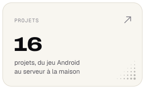
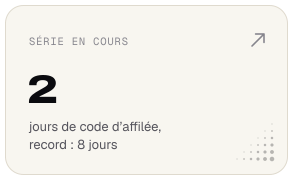
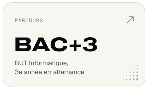
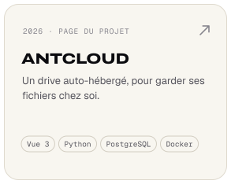
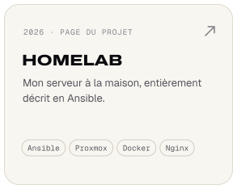
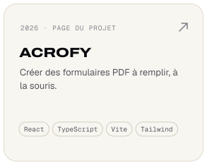
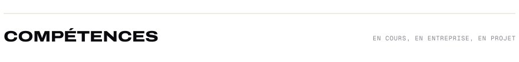
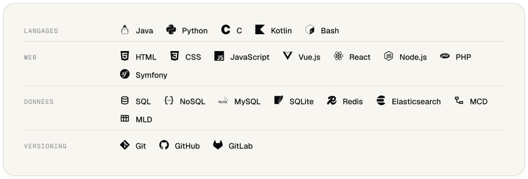

<!-- Généré par scripts/cartes.py à partir de donnees/profil.json : modifier ces fichiers, pas celui-ci.
     Les cartes sont redessinées chaque jour par .github/workflows/cartes.yml. -->

<a href="https://antlabs.fr"><picture><source media="(prefers-color-scheme: dark)" srcset="./cartes/hero-sombre.svg" /></picture></a> 
<picture><source media="(prefers-color-scheme: dark)" srcset="./cartes/contributions-sombre.svg" /></picture> 
<a href="https://antlabs.fr/#projets"><picture><source media="(prefers-color-scheme: dark)" srcset="./cartes/tuile-1-sombre.svg" /></picture></a><a href="https://github.com/rioulantoine"><picture><source media="(prefers-color-scheme: dark)" srcset="./cartes/tuile-2-sombre.svg" /></picture></a><a href="https://antlabs.fr/#parcours"><picture><source media="(prefers-color-scheme: dark)" srcset="./cartes/tuile-3-sombre.svg" /></picture></a> 
<a href="https://antlabs.fr/#projets"><picture><source media="(prefers-color-scheme: dark)" srcset="./cartes/titre-projets-sombre.svg" /></picture></a> 
<a href="https://antlabs.fr/projets/antcloud/"><picture><source media="(prefers-color-scheme: dark)" srcset="./cartes/projet-1-sombre.svg" /></picture></a><a href="https://antlabs.fr/projets/homelab/"><picture><source media="(prefers-color-scheme: dark)" srcset="./cartes/projet-2-sombre.svg" /></picture></a><a href="https://antlabs.fr/projets/acrofy/"><picture><source media="(prefers-color-scheme: dark)" srcset="./cartes/projet-3-sombre.svg" /></picture></a> 
<a href="https://antlabs.fr/#competences"><picture><source media="(prefers-color-scheme: dark)" srcset="./cartes/titre-competences-sombre.svg" /></picture></a> 
<picture><source media="(prefers-color-scheme: dark)" srcset="./cartes/competences-sombre.svg" /></picture>

<a href="https://antlabs.fr">antlabs.fr</a> &nbsp;·&nbsp; <a href="https://www.linkedin.com/in/antoine-rioul-9a13b6339/">LinkedIn</a> &nbsp;·&nbsp; <a href="mailto:rioul.antoine@gmail.com">rioul.antoine@gmail.com</a>

